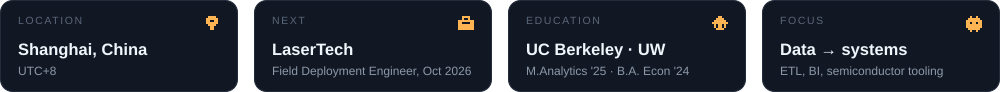
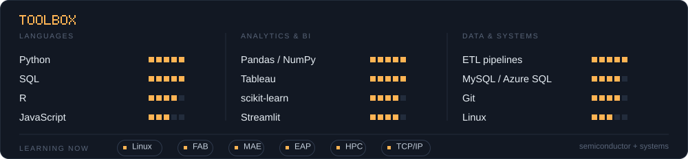

<table>
<tr>
<td width="33%" valign="top"></td>
<td width="33%" valign="top"></td>
<td width="33%" valign="top"></td>
</tr>
<tr>
<td valign="top"></td>
<td valign="top"></td>
<td valign="top"></td>
</tr>
</table>

Data earns its value by serving people. &nbsp;·&nbsp; <a href="mailto:franklin532232@gmail.com">franklin532232@gmail.com</a> All images are hand-built SVG (no external services); the contribution chart refreshes daily with GitHub Actions.

