


 

Hi, I'm **Frank** (Tzuyang Lin, 林子洋). I like taking messy, real-world data and turning it into something people can actually use: ETL pipelines, dashboards and analysis for clean-energy and carbon-removal teams, and now factory-floor systems for the semiconductor industry.
Based in **Shanghai** · UC Berkeley M.Analytics '25 · UW Econ + Informatics '24 · joining **LaserTech** as a Field Deployment Engineer in late October 2026.
Outside work: cooking, R&B, and trying every new tool I can find.

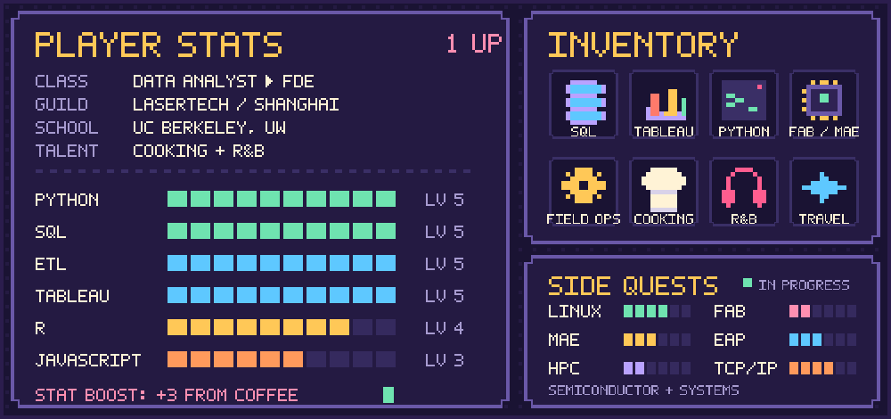
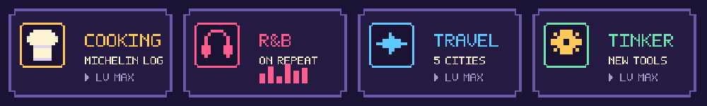

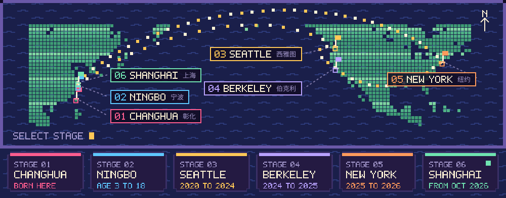

<table>
<tr>
<td width="33%" valign="top"><a href="https://github.com/Zzyang0/Zzyang0.github.io">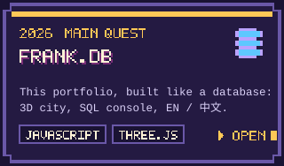</a></td>
<td width="33%" valign="top"><a href="https://github.com/Zzyang0/MassSave_Project">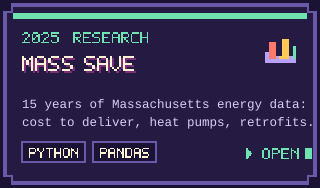</a></td>
<td width="33%" valign="top"><a href="https://github.com/Zzyang0/Takachar_kobo_sharepoint_pipeline">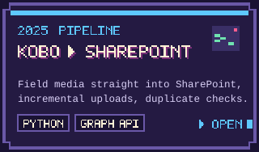</a></td>
</tr>
<tr>
<td valign="top"><a href="https://github.com/Zzyang0/AccentRecognition">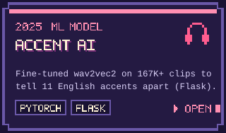</a></td>
<td valign="top"><a href="https://github.com/Zzyang0/ML-PROJECT-Predictive-Modeling-and-Clustering-for-Chronic-Disease-Risk">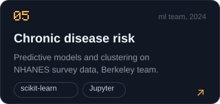</a></td>
<td valign="top"><a href="https://github.com/Zzyang0/Covid_19_analysis---Python">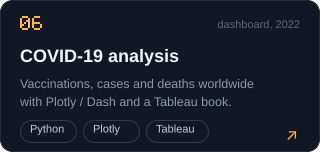</a></td>
</tr>
</table>

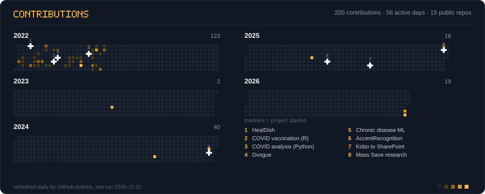

Every image here is hand-built pixel-art SVG (no external services). The crop field refreshes itself daily with GitHub Actions. Say hi: <a href="mailto:franklin532232@gmail.com">franklin532232@gmail.com</a>
