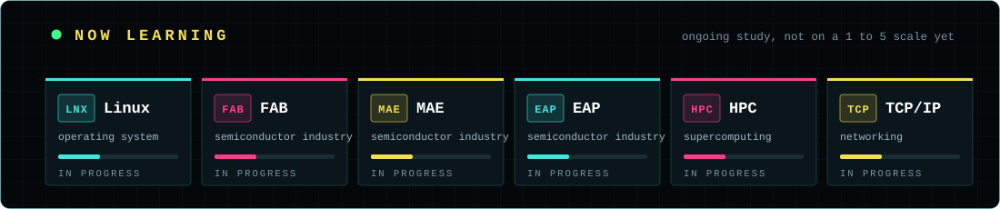

<div align="center">


<br>

[](https://zzyang0.github.io)
[](https://www.linkedin.com/in/tzuyang-frank-lin-982b56225/)
[](https://www.instagram.com/zzyang0528/)
[](mailto:franklin532232@gmail.com)


</div>

## `> whoami`

```sql
frank.db=# SELECT * FROM frank;
+-----------+-----------------------------------------------------------+
| name      | Tzuyang (Frank) Lin                                       |
| role      | Data Analyst -> Field Deployment Engineer                 |
| based_in  | Shanghai, CN                                              |
| studied   | UC Berkeley (M. Analytics '25), UW (B.A. Econ + Info '24) |
| next      | LaserTech, Shanghai (starts late Oct 2026)                |
| languages | English, Chinese                                          |
| motto     | Data earns its value by serving people.                   |
+-----------+-----------------------------------------------------------+
-- 7 rows in set (0.00 sec)
```

I like taking messy, real-world data and turning it into something people can actually use: ETL pipelines, dashboards and analysis for clean-energy and carbon-removal teams, and now factory-floor systems for the semiconductor industry. Outside work: **cooking**, **R&B**, and trying every new tool I can find.

<div align="center"></div>

## `> footprints`

<div align="center">

</div>

<div align="center"></div>

## `> now_learning`

<div align="center">

</div>

<div align="center"></div>

## `> toolbox`

<table>
<tr>
<td valign="top" width="33%">

**Languages**<br><br>


</td>
<td valign="top" width="33%">

**Analytics &amp; BI**<br><br>


</td>
<td valign="top" width="33%">

**Data &amp; systems**<br><br>


</td>
</tr>
</table>

<div align="center"></div>

## `> featured_projects`

<table>
<tr>
<td valign="top" width="33%">

### [FRANK.DB](https://github.com/Zzyang0/Zzyang0.github.io)
This portfolio, built like a database: 3D neon city, footprints globe, SQL console, EN / 中文.<br>
`JavaScript` `Three.js`

</td>
<td valign="top" width="33%">

### [Mass Save research](https://github.com/Zzyang0/MassSave_Project)
15 years of Massachusetts energy-efficiency data: cost-to-deliver, heat-pump adoption, retrofit funnel.<br>
`Python` `Pandas`

</td>
<td valign="top" width="33%">

### [Kobo → SharePoint pipeline](https://github.com/Zzyang0/Takachar_kobo_sharepoint_pipeline)
Streams field media straight into SharePoint with incremental uploads and duplicate detection.<br>
`Python` `Microsoft Graph`

</td>
</tr>
<tr>
<td valign="top">

### [AccentRecognition](https://github.com/Zzyang0/AccentRecognition)
Fine-tuned wav2vec2 on 167K+ clips to tell 11 English accents apart, with a Flask demo.<br>
`PyTorch` `Flask`

</td>
<td valign="top">

### [Chronic disease risk](https://github.com/Zzyang0/ML-PROJECT-Predictive-Modeling-and-Clustering-for-Chronic-Disease-Risk)
Predictive modeling and clustering on NHANES survey data (Berkeley ML team project).<br>
`scikit-learn` `Jupyter`

</td>
<td valign="top">

### [COVID-19 analysis](https://github.com/Zzyang0/Covid_19_analysis---Python)
Vaccination, cases and deaths worldwide, with interactive Plotly / Dash charts and a Tableau workbook.<br>
`Python` `Plotly` `Tableau`

</td>
</tr>
</table>

<div align="center"></div>

## `> contributions`

<div align="center">

</div>

<div align="center"></div>

<div align="center">

**Data earns its value by serving people.**

[zzyang0.github.io](https://zzyang0.github.io) · [LinkedIn](https://www.linkedin.com/in/tzuyang-frank-lin-982b56225/) · [Instagram](https://www.instagram.com/zzyang0528/) · franklin532232@gmail.com

<sub>Banner, map and heatmap are hand-built SVGs (no external services). The heatmap refreshes itself every day with GitHub Actions.</sub>

</div>
